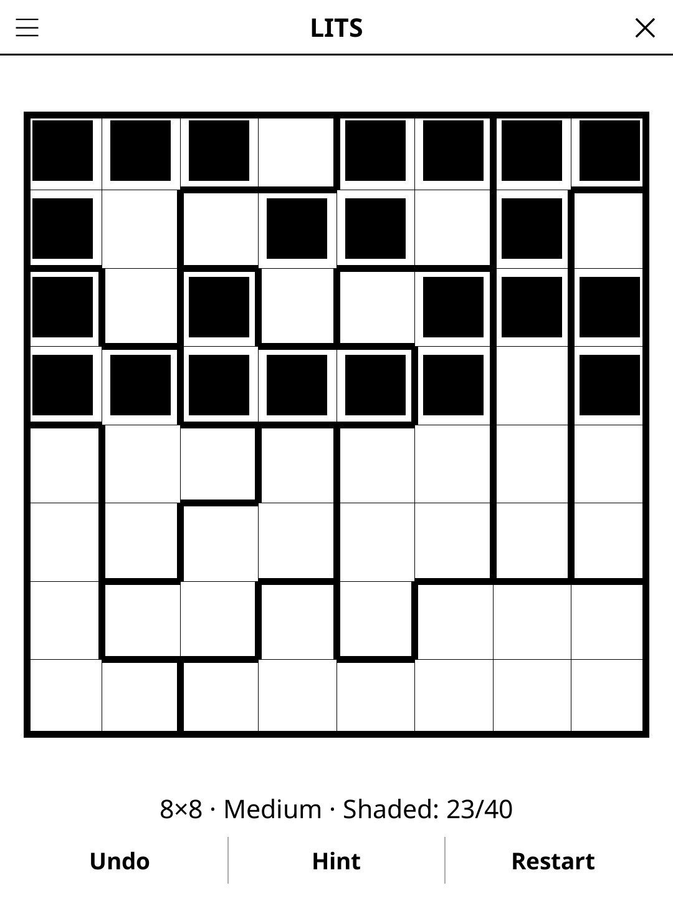

# lits.koplugin

A LITS puzzle plugin for [KOReader](https://github.com/koreader/koreader).

## Screenshot

## Rules

Shade one tetromino — four cells joined side by side, shaped like an L, I, T
or S — in every outlined region. Two tetrominoes of the same shape may not
touch side by side across a region border (rotations and mirror images count
as the same shape). All shaded cells form one connected group, and no 2×2
square is entirely shaded.

## Features

- **Generated puzzles, one solution each** — every grid is checked by an
  exhaustive solver before you see it, and can be solved by logic alone
- **Three sizes** — 7×7, 8×8, 10×10
- **Three difficulty levels**, graded by how much reasoning the solver needs
  beyond fitting pieces into regions: easy takes at most one small case
  analysis, hard takes several, or a case analysis on a wide-open region, or a
  one-step "what if" trial
- **Live rule check** — a shaded cell that already breaks a rule is crossed out
  (too many cells in a region, a 2×2 block, four cells that are no tetromino,
  two same-shaped pieces touching)
- **Hint** — two taps: the first says which cell is about to give, the second
  acts on it. A cell that contradicts the solution is always reported before a
  fresh one is revealed
- **Undo, Restart, Show solution, timer**, and auto-save of the game in
  progress

## Installation

1. Download `lits.koplugin.zip` from the [latest release](../../releases/latest).
2. Extract into the `plugins/` folder of your KOReader data directory.
3. Restart KOReader.
4. Open the menu → **Tools** → **LITS**.

## Controls

| Action | How |
|--------|-----|
| Shade / dot / blank | Tap a cell (cycles) |
| Blank a cell | Hold it |
| Undo, hint, clear the grid | **Undo**, **Hint**, **Restart** |
| New game, size, difficulty, solution, rules | Menu (top left) |

## How the puzzles are made

The generator grows a connected shading one legal tetromino at a time (the
denser of two tries), gives every piece a region grown over the empty cells
(each empty cell joins the neighbouring region where it lets in the fewest
extra placements), then reshapes the regions until the solution counter finds
exactly one answer, and finally reshapes toward the requested difficulty,
checked by the logical solver. When moving a cell to another region would cut
its region in two, the cut-off part goes along with it: that is what breaks
the usual last tie, a piece that can slide one cell along a corridor.

Generation averages under 0.1 s on a desktop and took at most about 0.45 s over
100 seeds at every size and level; a device several times slower shows a
progress bar when it takes a moment. Every limit in the generator counts moves
or search steps, never time, so the same seed builds the same grid on every
device — which the Daily Challenge relies on.

## Known limitations

- There is no 6×6: a grid that small never needs more than the basic rules,
  so it could only ever be easy.

## License

GPL-3.0 — see [LICENSE](LICENSE).
